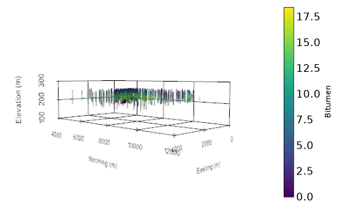
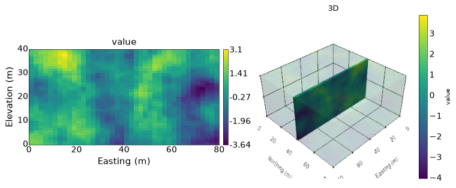
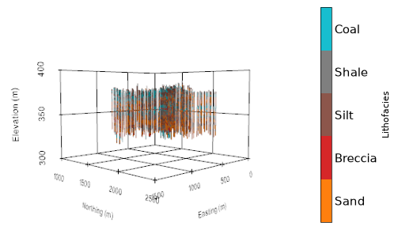

(view3d)=
# 3D Viewer

PyGeoStat can show drill holes, block models and sub-blocks in 3D. It is built on
[PyVista](https://docs.pyvista.org/), so you do not need to know PyVista to use it. The 3D functions work like
the 2D plots: `gs.view3d()` takes a `DataFile` or `DataFrame` and the name of a variable, and
several calls can share one scene the way 2D plots share `ax`.

:::{seealso}
For every argument, see the {ref}`3D Viewer API Reference <plotting3d>`.
:::

## Installation

PyVista is an optional dependency, so the normal PyGeoStat install does not include it:

```bash
pip install pygeostat[view3d]
```

## Drill holes

`gs.view3d()` returns a `Viewer`. Call `show()` to open it in an interactive window, or `show_static()`
to draw it as a picture on a matplotlib axis. This example uses the oil sands data that ships with
PyGeoStat. The samples of each drill hole are joined with `trace=True`:

```python
import pygeostat as gs

data = gs.ExampleData('oilsands')
viewer = gs.view3d(data, 'Bitumen', trace=True, radius=15)
viewer.add_ruler()
viewer.set_vertical_exaggeration(10)
viewer.show()                    # interactive window
fig, ax = viewer.show_static()   # or a matplotlib figure
```



How the drill holes are drawn depends on the columns of your data:

- **Intervals** with a start and an end: `gs.view3d(data, 'Au', start=('xs', 'ys', 'zs'), end=('xe', 'ye', 'ze'))`
  draws one cylinder per interval.
- **Samples** along a hole: `trace=True` joins the samples of each drill hole (from `DataFile.dh`) with
  cylinders, each with the value of its upper sample. Samples further apart than `max_gap` (by default
  three times the typical spacing) are not joined.
- **Points**: with neither, each row is a point at the coordinates of the `DataFile`.

The coordinates, drill hole id and variable are read from the `DataFile` when it knows them. For a
`DataFrame`, pass `x`, `y`, `z` and `dh`.

## Block models

A block model on a regular grid needs its `GridDef` (it is read from `DataFile.griddef` when set).
Sub-blocks of any size need one row per block, with the block centre and its three sizes:

```python
blocks = gs.ExampleData('3d_grid')
griddef = gs.GridDef([40, 1, 2, 40, 1, 2, 40, 0.5, 1])
gs.view3d(blocks, 'value', griddef=griddef)

# sub-blocks: columns x, y, z (centre) and xsize, ysize, zsize
gs.view3d(subblocks, 'Au', x='x', y='y', z='z', size=('xsize', 'ysize', 'zsize'))
```

Every row is drawn where its coordinates say. A block with a wrong coordinate shows up away from the
others; it is not an error.

## Layers and slices

Pass `viewer=` to add to a scene. `orient`, `slice_number` and `slice_thickness` work as in
{func}`gs.slice_plot() <pygeostat.plotting.slice_plot.slice_plot>`: `orient` is `'xy'`, `'xz'` or `'yz'`.
This puts a slice of the model inside a see-through copy of it, next to the 2D plot of the same slice:

```python
import matplotlib.pyplot as plt

viewer = gs.view3d(blocks, 'value', griddef=griddef, opacity=0.15)
gs.view3d(blocks, 'value', griddef=griddef, orient='xz', slice_number=20, viewer=viewer)
viewer.add_ruler()

fig, (left, right) = plt.subplots(1, 2, figsize=(10, 4))
gs.slice_plot(blocks, var='value', griddef=griddef, orient='xz', slice_number=20, ax=left)
viewer.show_static(ax=right, title='3D')
```



- **Data without a grid** (drill holes, sub-blocks) are sliced with `slice_coordinate=` (the position along
  the axis not in `orient`) and `pointtol=` (how far either side of it to show). Drill holes are cut at
  that distance.
- **`threshold=(min, max)`** shows only values in that range.
- A slice or a threshold keeps the colours of the full range of the variable (unless you pass `clim`), and
  the ruler keeps the whole model, so moving the slice does not change what the colours mean.

## Categories

Pass `catdict` to colour a categorical variable (a rock type, for example). The colours match
{func}`gs.location_plot() <pygeostat.plotting.location_plot.location_plot>`. If the `DataFile` has a `cat`
column, `gs.view3d(data, data.cat)` uses its `catdict` without anything else:

```python
data = gs.ExampleData('point3d_ind_mv')
catdict = {1: 'Sand', 2: 'Breccia', 3: 'Silt', 4: 'Shale', 5: 'Coal'}
viewer = gs.view3d(data, 'Lithofacies', trace=True, radius=4, catdict=catdict)
viewer.add_ruler()
viewer.set_vertical_exaggeration(10)
```



## Axes, exaggeration and views

- `viewer.add_ruler()` draws axes titled from `gs.Parameters` (`plotting.xname`, `plotting.unit`, ...), with
  labels on round numbers.
- `viewer.set_vertical_exaggeration(10)` stretches the scene vertically. The ruler keeps the real elevations.
- `viewer.get_camera()` returns the current view as a dictionary of plain numbers. Save it with `json`,
  and give it back to `viewer.set_camera()` to get the same view again, in `show()` and in `show_static()`.

## Static figures

`viewer.show_static()` returns a matplotlib `(fig, ax)`, so a 3D view can sit in a figure with 2D plots,
have a legend and be saved like any matplotlib figure. It draws the scene off screen, with the ruler, the
vertical exaggeration and the camera of the viewer. It works without a display, which is also how the
tests run.

## What is not included yet

This first version is the scripting interface. An interactive layer panel (switching layers on and off,
sliders for the slice, picking a block to see its values) and surfaces from DXF files will follow.
